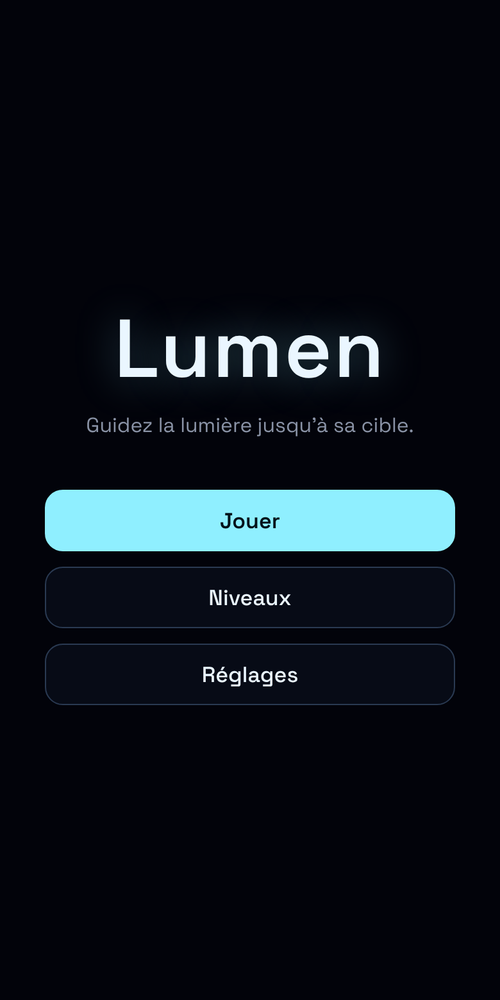
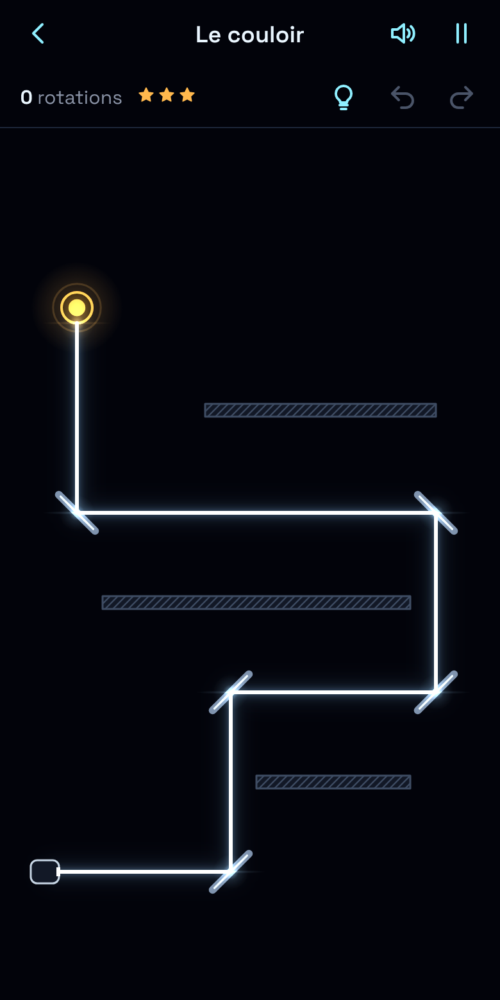
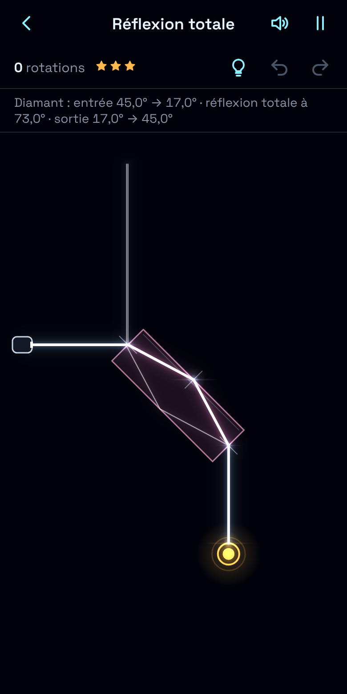
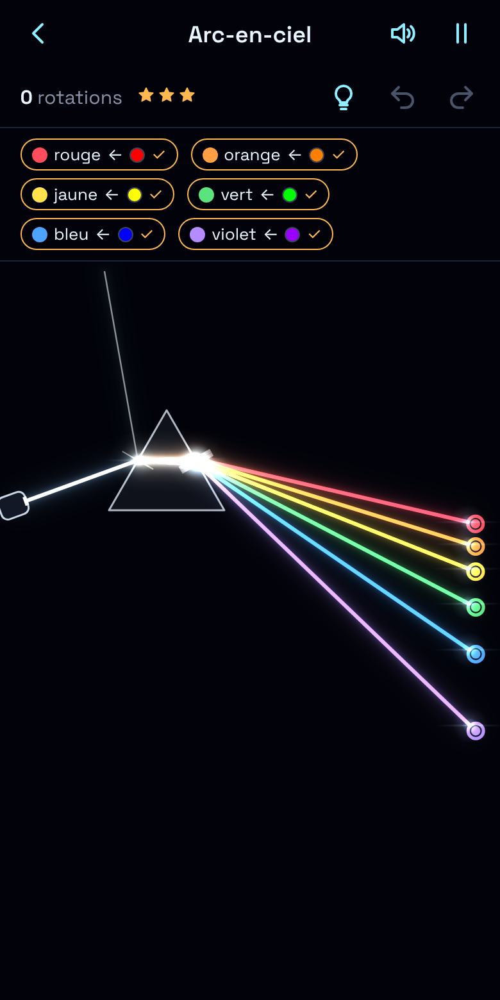

# Lumen

Lumen est un jeu de puzzle sur la lumière, jouable dans le navigateur sur téléphone et sur ordinateur. Tournez et déplacez miroirs, blocs transparents, verres dépolis, prismes et filtres pour guider la lumière jusqu'aux cibles.

44 niveaux en quatre chapitres :

- **Réflexion** (12) : miroirs à une ou deux faces, cibles traversables, plusieurs sources.
- **Réfraction** (10) : eau, verre et diamant, loi de Snell-Descartes, réflexion totale, bac de matières.
- **Diffusion** (10) : verre dépoli qui étale le rayon en éventail, cristaux à allumer, brume qui absorbe.
- **Dispersion** (12) : prisme qui sépare la lumière blanche en six couleurs, filtres, mélange additif.

| Menu                               | Réflexion                                     | Réfraction                                           | Dispersion                                      |
| ---------------------------------- | --------------------------------------------- | ---------------------------------------------------- | ----------------------------------------------- |
|  |  |  |  |

## Comment jouer

| Action                                    | Tactile / souris                                   | Clavier                                 |
| ----------------------------------------- | -------------------------------------------------- | --------------------------------------- |
| Sélectionner une pièce                    | Toucher ou cliquer la pièce                        | Tab / Maj+Tab sur le plateau            |
| Tourner (pas de 15°)                      | Glisser la poignée ou l'anneau cyan                | R / Maj+R (flèches pour une pièce fixe) |
| Déplacer (pièce avec un anneau au centre) | Glisser la pièce                                   | Flèches                                 |
| Poser un bloc / le remettre au bac        | Bac de matières en bas, bouton « remettre au bac » |                                         |
| Ouvrir l'éventail du verre dépoli         | Curseur « Dépoli du verre »                        |                                         |
| Annuler / Rétablir                        | Boutons en haut à droite                           | Ctrl+Z / Ctrl+Maj+Z (ou Ctrl+Y)         |
| Indice                                    | Bouton ampoule                                     | H                                       |
| Désélectionner, puis pause                | Toucher une zone vide, bouton pause                | Échap                                   |
| Temps de frame                            |                                                    | D                                       |

Les étoiles dépendent du nombre de rotations (crans de 15°). Les Réglages règlent l'intensité du faisceau et des impacts (le cœur du rayon reste toujours net), les animations, le son et un mode daltonien qui ajoute un symbole à chaque couleur.

## Lancer en local

Node 20.19+ ou 22.12+.

```sh
npm install
npm run dev        # http://localhost:5173, et l'adresse réseau local pour tester sur téléphone
```

## Tester

```sh
npm test           # Vitest : moteur optique, niveaux (chacun a une solution vérifiée), sauvegarde, interactions
npm run lint       # ESLint + Prettier
npm run typecheck  # TypeScript strict
npm run test:e2e   # Playwright, téléphone et ordinateur, sur le build servi sous /Lumen/
```

## Construire et déployer

```sh
npm run build      # dist/ : site statique, chemins relatifs, service worker
npm run preview    # sert dist/ en local
npm run package    # build + lumen-dist.zip (fichiers à la racine), à déposer à la main si besoin
```

Le déploiement est automatique : chaque push sur `master` lance `.github/workflows/deploy.yml` (installation, vérification des types, tests, build, publication sur GitHub Pages). Le jeu est alors en ligne à `https://<utilisateur>.github.io/<dépôt>/`.

Réglage à faire une seule fois :

1. Sur GitHub, ouvrir **Settings > Pages**.
2. Dans **Build and deployment > Source**, choisir **GitHub Actions**.
3. Pousser sur `master` (ou lancer le workflow à la main dans l'onglet Actions).

Le jeu est installable (manifeste et service worker) et fonctionne hors ligne après une première visite ; chaque nouvelle version remplace l'ancien cache.

## Structure du code

```text
src/engine/    moteur optique pur (aucun accès DOM ni Canvas) : tracé, réflexion, réfraction, diffusion, dispersion
src/render/    dessin Canvas : pièces, halos en cache, cœur du rayon, sélection, symboles
src/game/      état et interactions : sélection, rotation, déplacement, historique, règles, son, tutoriel, qualité
src/ui/        écrans en DOM : menu, niveaux, jeu, réglages, navigation par hash
src/levels/    niveaux JSON par chapitre et leur schéma validé
src/storage/   sauvegarde localStorage versionnée
tests/         Vitest ; e2e/ : Playwright ; scripts/ : post-build et archive
docs/          plan de développement et captures
```

Le contexte du projet (style, règles, architecture) est décrit dans `CLAUDE.md`.

## Licence

Code sous licence MIT (voir `LICENSE`). Police Space Grotesk : SIL Open Font License 1.1 (`public/fonts/OFL.txt`).
